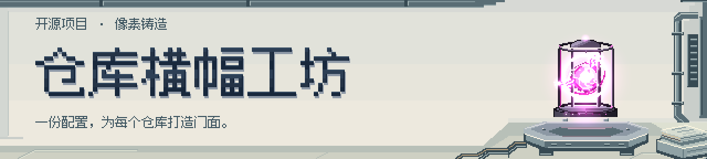
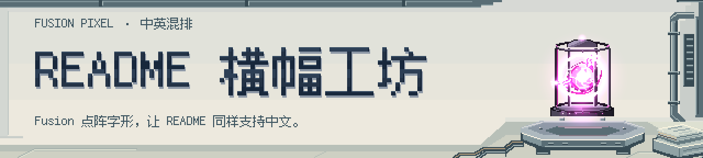

<!-- readme-banner:start -->
<picture>
  <source media="(prefers-color-scheme: dark)" srcset="assets/banner/banner.dark.svg">
  
</picture>
<!-- readme-banner:end -->

# readme-banner

[](https://github.com/abworks-dev/readme-banner/actions/workflows/ci.yml)

用 JSON 配置在本地生成适合 README 的浅 / 深色横幅；需要时，再显式更新指定文档中的受管块。无需远程截图服务。

[预设预览](<#预设预览>) · [快速开始](<#快速开始>) · [配置与安全](<#配置与安全>) · [Agent skill](<#给-agent-使用>) · [开发与研究](<#开发与研究>) · [许可](<#许可与第三方>)

## 能力与状态

| 能力 | 当前状态 | 使用方式 |
| --- | --- | --- |
| ASCII 横幅 | **已可用**，`v0.1.0` 唯一注册的 CLI preset | `--preset ascii`；输出两张 SVG，保留原生动画 |
| 四套 ASCII 主题 | **已可用** | `terminal` / `ocean` / `neon` / `minimal`，支持自定义标题颜色 |
| 中文 / 中英混排像素横幅 | **实验性、可复现样例**，未注册到 CLI、不在 `v0.1.0` 中 | 独立生成脚本；**不能使用 `--preset pixel`** |
| 图片转 ASCII、正面遮罩动画 | **独立样例**，不是现有 CLI 配置选项 | [转换与遮罩说明](<examples/image-to-ascii/README.md>) |

`preset` 决定布局与渲染方式，`theme` 决定配色，两者不是一回事。本项目提供本地 CLI、程序化扩展接口和可移植 skill，不提供托管服务、GitHub Action 或 MCP 服务。

由 [abworks-dev](https://github.com/abworks-dev) 维护，仓库为 [abworks-dev/readme-banner](https://github.com/abworks-dev/readme-banner)。本文展示当前仓库内容；固定标签 `v0.1.0` 的代码不因后续样例更新而改变。`@readme-banner/cli` **尚未发布到 npm**。

## 预设预览

### ASCII · 四套主题

同一渲染 preset 的四种独立配色与选项组合，均提供浅 / 深色 SVG。

#### terminal · block / double / donut / glint

<picture>
  <source media="(prefers-color-scheme: dark)" srcset="examples/gallery/ascii-terminal.dark.svg">
  <source media="(prefers-color-scheme: light)" srcset="examples/gallery/ascii-terminal.light.svg">
  
</picture>

#### ocean · slim / single / earth / glint

<picture>
  <source media="(prefers-color-scheme: dark)" srcset="examples/gallery/ascii-ocean.dark.svg">
  <source media="(prefers-color-scheme: light)" srcset="examples/gallery/ascii-ocean.light.svg">
  
</picture>

#### neon · italic / double / dna-helix / type

<picture>
  <source media="(prefers-color-scheme: dark)" srcset="examples/gallery/ascii-neon.dark.svg">
  <source media="(prefers-color-scheme: light)" srcset="examples/gallery/ascii-neon.light.svg">
  
</picture>

#### minimal · mixed / none / 无 art / still

<picture>
  <source media="(prefers-color-scheme: dark)" srcset="examples/gallery/ascii-minimal.dark.svg">
  <source media="(prefers-color-scheme: light)" srcset="examples/gallery/ascii-minimal.light.svg">
  
</picture>

### Pixel · 宽幅像素工坊（实验性）

文字优先的 **1280×288（约 4.44:1）** 横幅：640×144 原生场景整数 2× 导出，保留 1px 级细像素材质与游戏 VFX，不是把旧图压扁或降采样成粗马赛克。使用本地 **Fusion Pixel Font** 支持中文与中英混排；原色 **APNG 为 30fps、72 帧、2.4 秒循环**。

> 这是独立的可复现设计样例，不是已发布的 `pixel` preset。复现步骤与工具准备见[样例说明](<examples/pixel-game-vfx/README.md#新版宽幅-readme-构图推荐>)；来源见[原型第三方声明](<examples/pixel-game-vfx/THIRD_PARTY_NOTICES.md>)。

#### 中文

<picture>
  <source media="(prefers-reduced-motion: reduce) and (prefers-color-scheme: dark)" srcset="examples/pixel-game-vfx/wide-chinese/banner.dark.png">
  <source media="(prefers-reduced-motion: reduce)" srcset="examples/pixel-game-vfx/wide-chinese/banner.light.png">
  <source media="(prefers-color-scheme: dark)" srcset="examples/pixel-game-vfx/wide-chinese/banner.dark.animated.png">
  
</picture>

[深色静态 PNG](<examples/pixel-game-vfx/wide-chinese/banner.dark.png>) · [浅色静态 PNG](<examples/pixel-game-vfx/wide-chinese/banner.light.png>) · [深色动画 APNG](<examples/pixel-game-vfx/wide-chinese/banner.dark.animated.png>) · [浅色动画 APNG](<examples/pixel-game-vfx/wide-chinese/banner.light.animated.png>)

#### 中英混排

<picture>
  <source media="(prefers-reduced-motion: reduce) and (prefers-color-scheme: dark)" srcset="examples/pixel-game-vfx/wide-mixed/banner.dark.png">
  <source media="(prefers-reduced-motion: reduce)" srcset="examples/pixel-game-vfx/wide-mixed/banner.light.png">
  <source media="(prefers-color-scheme: dark)" srcset="examples/pixel-game-vfx/wide-mixed/banner.dark.animated.png">
  
</picture>

[深色静态 PNG](<examples/pixel-game-vfx/wide-mixed/banner.dark.png>) · [浅色静态 PNG](<examples/pixel-game-vfx/wide-mixed/banner.light.png>) · [深色动画 APNG](<examples/pixel-game-vfx/wide-mixed/banner.dark.animated.png>) · [浅色动画 APNG](<examples/pixel-game-vfx/wide-mixed/banner.light.animated.png>)

以上图片来自仓库内资源。像素预览在支持相应媒体条件的查看器中自适应深浅主题，并为 reduced-motion 提供静态 PNG。SVG / APNG 动画及媒体选择取决于查看器；尚未验证 GitHub/Camo 的实际播放，不承诺跨客户端兼容性。

更多：[图片转 ASCII：仅 Logo 正面扫光、其余区域静止](<examples/image-to-ascii/README.md>)，含显式遮罩、静态回退与复现命令；这里不再重复整套画廊。

## 快速开始

**CLI 需要 Node.js ≥22 与 npm。** 独立像素原型的源码工具链需要 **Node.js ≥22.18，推荐 Node 24**，并需准备固定上游检出；不要把原型要求或样例脚本当作 `v0.1.0` CLI 安装步骤。

### 本地源码运行

在本工具源码目录执行；`npm install` 会通过 `prepare` 自动编译 TypeScript：

```sh
npm install
node bin/readme-banner.mjs --help

# --cwd 是要添加横幅的目标仓库，不是工具源码目录
# init 只创建配置，不生成图片、不改 README
node bin/readme-banner.mjs init --cwd "../my-project" --preset ascii --theme ocean --title "MY PROJECT" --tagline "Build something useful" --art donut --effect glint

# 生成两张 SVG，向 stdout 输出可复制的嵌入片段；不改 README
node bin/readme-banner.mjs generate --cwd "../my-project"
```

**只有明确授权更新目标文档后，才添加 `--readme`：**

```sh
node bin/readme-banner.mjs generate --cwd "../my-project" --readme "README.md"

# 只检查图片与指定 README 的受管块，不写文件
node bin/readme-banner.mjs generate --cwd "../my-project" --readme "README.md" --check
```

把 `../my-project` 换成自己的目标目录，按所用 shell 正确引用路径与文本；不要把不可信输入拼成命令。嵌入 URL 相对于目标文档所在目录计算，应使用实际生成片段，不手动照抄其他目录的路径。

### 从 GitHub 固定标签运行

需要本机 Git，首次安装需要网络；固定标签只固定工具代码，安装仍可能执行依赖与构建脚本，应只运行信任的来源。

```sh
npx --yes --package github:abworks-dev/readme-banner#v0.1.0 readme-banner --help
npx --yes --package github:abworks-dev/readme-banner#v0.1.0 readme-banner init --cwd "../my-project" --theme ocean --title "MY PROJECT"
npx --yes --package github:abworks-dev/readme-banner#v0.1.0 readme-banner generate --cwd "../my-project"
```

需要编辑目标文档时才为最后一条添加 `--readme "README.md"`。不要使用 `npx @readme-banner/cli`，该包尚未发布。

若 npm 报 `EALLOWGIT`，**仅在用户已授权运行此可信仓库、且组织策略允许时**，支持该选项的 npm 可为单次命令添加：

```sh
npx --allow-git=root --yes --package github:abworks-dev/readme-banner#v0.1.0 readme-banner --help
```

后续 `init` / `generate` 同样将选项放在 `npx` 后。**不要修改全局 npm 配置放开 Git 来源**；未授权或策略禁止时停止询问。旧版 npm 不支持该选项时，使用普通命令或经授权的源码安装。

## 配置与安全

`init` 默认在目标仓库创建 [banner.config.json](<banner.config.json>)，高级设置直接编辑 JSON：

```json
{
  "schemaVersion": 1,
  "preset": "ascii",
  "theme": "ocean",
  "title": "MY PROJECT",
  "tagline": "Build something useful",
  "outputDir": "assets/banner",
  "options": {
    "font": "block",
    "shadow": "double",
    "effect": "glint",
    "art": "donut",
    "place": "left",
    "speed": 1,
    "background": false
  }
}
```

- **配置与字形**：可选 `colors` 接受 1–8 个 `#rrggbb` 标题颜色。ASCII 大标题要求所选字体具备全部字形，最多 120 字符；中文可放普通文本 `tagline`（最多 240 字符），不能把像素样例的中文标题能力套到 ASCII CLI。`mixed` 保留英文大小写，其他字体转大写。
- **明确写入**：`init` 只写配置，已有文件默认拒绝覆盖；`--force` 须单独确认。`generate` 默认只写 [banner.light.svg](<assets/banner/banner.light.svg>) / [banner.dark.svg](<assets/banner/banner.dark.svg>) 并返回片段；只有显式 `--readme` 才维护指定已存在 `.md` 文件的受管块，块外内容保留。不要在同一文档中重复完整受管标记，包括代码示例。
- **只读检查**：`--check` 不写文件，缺失、过期或无效输入会非零退出；只有同时传入 `--readme` 才检查该文档。`generate --json` 是机器可读结果，**仍会生成图片**，不是只读模式。
- **目标边界**：`--cwd` 限定配置、输出与文档路径；拒绝根目录外路径、符号链接逃逸，以及硬链接数大于 1 的现有文件。不要为绕过错误而扩大写入范围。
- **数据而非代码**：配置不执行 JavaScript、不加载任意插件，不接受远程用户 SVG 作为 art。它也不提供恶意代码沙箱；安装工具、注册扩展或运行样例仍需信任对应代码。

字段、字体、art 与完整命令契约见[配置与运行参考](<skills/readme-banner/references/configuration.md>)；程序化扩展与信任边界见[架构说明](<docs/architecture.md>)。CLI 的 `--help`、`presets --json`、`themes --json` 可查看当前可用能力，不修改项目。

## 给 agent 使用

可移植操作说明位于 [skills/readme-banner/SKILL.md](<skills/readme-banner/SKILL.md>)：

```sh
npx skills add abworks-dev/readme-banner --skill readme-banner
```

安装 skill 不会自动生成横幅。请说明目标仓库、标题、主题，以及是否授权插入文档。默认流程先 `init` 后 `generate`，不自动编辑文档、不提交、不推送、不发布，保留无关改动。

## 开发与研究

```sh
npm run build
npm run check
npm test

# 构建后重新生成四套 ASCII 画廊
node examples/generate-gallery.mjs
```

以上是开发命令，不代表测试或 CI 已通过。[画廊脚本](<examples/generate-gallery.mjs>)与独立样例各有自己的产物；新 renderer 通过代码实现 `BannerPreset` 并由 `PresetRegistry.register()` 注册，不从 JSON 加载插件，详见[架构说明](<docs/architecture.md>)。

- **研究**：[像素预设设计](<docs/pixel-preset-design.md>) · [工具组合调研与实测](<docs/pixel-toolchain-research.md>) · [pixelfx 画风与像素密度分析](<docs/pixelfx-art-direction-analysis.md>)。这些是设计与研究记录，不等于正式 CLI 功能清单。
- **示例**：[图片转 ASCII 与遮罩动画](<examples/image-to-ascii/README.md>) · [像素工坊复现](<examples/pixel-game-vfx/README.md>) · [宽幅布局与验证](<examples/pixel-game-vfx/README.md#新版宽幅-readme-构图推荐>)。
- **字体**：[固定 Fusion 字库、来源与覆盖范围](<examples/pixel-game-vfx/fonts/README.md>) · [OFL 1.1 全文](<examples/pixel-game-vfx/fonts/LICENSE-OFL.txt>)及其中列出的继承许可。

## 许可与第三方

本项目**代码**采用 [MIT License](<LICENSE>)；ASCII renderer 使用 `ascii.rest@0.4.0`（MIT），完整归属、再分发要求与商标边界见[第三方说明](<THIRD_PARTY_NOTICES.md>)。内置品牌图案可用不等于获得商标授权或官方背书。

像素原型使用的 pxl / pixelfx / Pixelbolt 及已有 Energy core 特效另有[上游声明](<examples/pixel-game-vfx/THIRD_PARTY_NOTICES.md>)，不宣称这些上游素材由本项目原创。**随仓库分发的 Fusion Pixel Font 字体数据采用 SIL OFL 1.1，不是 MIT**；应保留[字体许可与继承声明](<examples/pixel-game-vfx/fonts/README.md#source-integrity-and-license>)。仅因使用该字体生成图片，并不要求图片本身采用 OFL。
