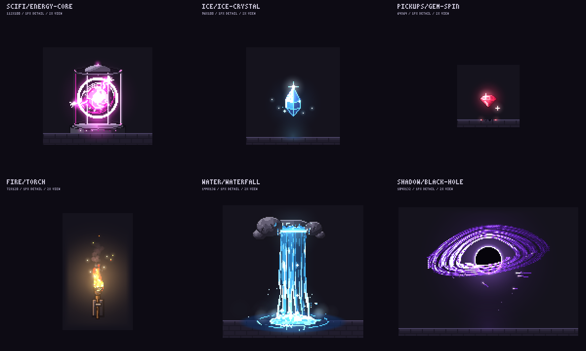
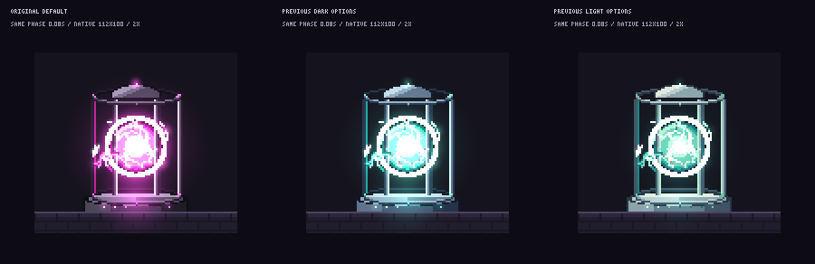

# pixelfx 画风、像素尺度与原型偏差分析

## 结论

用户觉得上一张横幅不像 pixelfx，是有依据的。它只证明了工具组合能工作，没有完成画风对齐。

pixelfx 的主要视觉语言是：**细像素游戏 VFX、1 px 级轮廓与材质细节、离散色阶、白热亮点、半透明体积和叠加辉光、分阶段的动作。** 不是给平面 UI 加粗像素字体，也不是把图片降采样成大马赛克。

上一张是我自行绘制的低细节界面构图，外加一个经过换色、减弱辉光和降低导出采样率的库特效。整体画风主要被界面排版支配，而不是由库的美术语言支配。

本次仅做分析与参考渲染，不修改原型横幅、正式 CLI、依赖或远端仓库。

## 1. 分析依据与边界

- 固定源码版本：`a84159688af3ca37a4be05a0d422b94451b2e24e`。
- 阅读官方画廊、README 动图、作者规范、绘制器、色彩与合成实现。
- 检查全部 244 个特效的元数据，区分特效、人物和画廊 UI。
- 原默认参数渲染六个代表特效；不换色、不降低光效，使用 2× 最近邻展示。
- 同一时刻、同一原生画布、同一背景比较 Energy core 的默认参数和上一张使用的参数。

官网画廊随视口、留白和详情模式变化显示倍率，画廊的一个 CSS 像素不等于一个美术像素。不能从网页截图中看到的方块大小，直接推断特效源分辨率。

## 2. 它究竟是什么画风

### 2.1 细像素，不是粗色块

官方要求以 24×38 px 的默认人物为尺度参照，细节落到 **1 个原生像素**，一个局部坐标单位就是一个像素。24×38 不是所有特效的大小。

- 用 1 px 高光、细环、弧线、拖尾与火星建立结构。
- 曲线有栅格台阶，但轮廓不是统一的厚黑描边。
- 金属、水晶、火焰等内部有可读的材质层次，而非单一平涂面。
- “有像素感”不等于把每个细节变成 4×4、8×8 色块。

例如 Energy core：核心基础半径 11 px；笼条只有约 3 px 宽，其中朝向核心的一面用 1 px 亮边表现受光。用几何结构和精细受光建立体积，而不是画一个大圆加几根粗线。

### 2.2 硬实体与软光并存

作者明确要求 **“Lines and light, not fills”**：优先细亮边、环和火星，大面积高饱和平涂通常不对。

亮度组织通常是：

`深冷阴影 → 有色中间调 → 浅色高光 → 极小的白热核心`

实体颜色使用离散色阶；光晕和烟雾则可以柔和：

- `color` 缓冲存实体颜色、透明度及部分抖动淡出。
- `light` 缓冲存逐像素叠加的光。
- 烟、雾和蒸汽使用真实半透明圆片，不要求画成棋盘格。
- 很亮的白色集中在热核心、细边、尖端；不是把全物体刷白。

因此，“不允许渐变”“必须只有 8 色”“不能有柔和辉光”都不符合这个库。

### 2.3 色阶不是整帧颜色上限

244 个特效中，232 个声明主色阶；12 个 moves 是由其他特效组合的动作，没有独立主色阶。

主色阶长度分布：

| 主色阶步数 | 特效数 |
|---:|---:|
| 2 | 1 |
| 4 | 1 |
| 6 | 12 |
| 7 | 42 |
| 8 | 154 |
| 9 | 22 |

这是**主色阶**，不是“每张图只能有八种颜色”。同一特效还可有独立的金属、木材、火星色阶，经过透明合成与叠加照明后，会产生更多 RGB 颜色。

本次六个默认特效的选定亮光峰值帧，在实际默认背景上合成后出现 **575–2978 种 RGB 颜色**。这只是所选帧的实测，不是整个库每一帧的范围。

### 2.4 时间密度也是画风的一部分

它不仅靠一张精细静帧：蓄力、释放、扩散、停留、衰减，以及烟、碎片、火星的次级动作共同构成效果。

- 默认导出元数据全部为 30fps。
- 实时播放由调用方时钟驱动；有状态模拟细分到 120Hz 或更细，不代表导出帧率是 120fps。
- 人物姿态约 12fps 的节奏与连续粒子可以并存。
- 有些细丝按 15Hz 更新，而不是所有层都按同一个低帧率跳动。
- 瞬态爆发可以只有 1–2 帧，然后长尾衰减。

静止物体只做均匀呼吸光，不能替代这种分层的时间编排。

## 3. 原生分辨率和“像素密度”

### 全库元数据统计

| 项目 | 固定版本实测 |
|---|---|
| 特效数 | 244 |
| 默认导出 FPS | 244 个均为 30 |
| 画布宽度最小 / 中位 / 最大 | 56 / 174 / 480 px |
| 画布高度最小 / 中位 / 最大 | 32 / 114 / 320 px |
| 最常见完整画布 | 320×180，共 23 个 |
| 循环 / 非循环 | 108 / 136 |

宽和高的中位数分别统计，**不能据此虚构“标准画布是 174×114”**。画布也是容纳光晕、粒子轨迹的范围，不等于实体占满的包围盒。

### 本次六个代表对象

| 特效 | 原生画布 | 主要细节尺度 | 默认导出 |
|---|---:|---:|---:|
| Gem spin | 64×64 | 1 px | 30fps |
| Torch | 72×120 | 1 px | 30fps |
| Ice crystal | 96×100 | 1 px | 30fps |
| Energy core | 112×100 | 1 px | 30fps |
| Waterfall | 144×136 | 1 px | 30fps |
| Black hole | 184×132 | 1 px | 30fps |

下图均为原生画布 **2× 最近邻**，因此 1 个美术像素显示为 2×2。没有为了凑卡片大小把不同特效各自拉伸；各图大小差异是原生尺寸差异。为清楚观察光照，选择每个效果一轮中 `light` 总能量最大的采样帧，不代表普通时刻都这么亮。

这里的“像素密度”至少应分开四件事：

1. **底层栅格**：一个原生像素最后显示多大。
2. **有效细节尺度**：一个物体是否真正用到 1 px 轮廓、亮点和材质变化。
3. **物体占比**：实体在构图中占多大，而不是只看导出画布尺寸。
4. **时间采样密度**：一秒展示多少变化，是否保留短暂的细节事件。

简单数有多少非背景像素，或追求更多随机噪点，不能代替这四项。

## 4. 上一张为什么不像

### 4.1 不是输出文件不够大，而是内容精细度不统一

原型逻辑画布 480×160，最近邻 2× 导出 960×320。特效的 1 px 细节正确地变成 2×2，没有被额外降分辨率。

但标题来自 3×5 字模，在场景内先 `scale: 4`，最后再放大 2×：

- 标题一个字模点：**8×8 输出像素**。
- 特效一个细节点：**2×2 输出像素**。
- 线性颗粒大小相差 4 倍；单个颗粒面积相差 16 倍。

这不是说大标题不能有粗笔画。问题是标题、按钮、纸张都以简单块状几何为主，而特效有丰富的 1 px 材质与受光。结果是“粗像素 UI + 细像素 VFX”，而非统一美术方向。

### 4.2 视觉主语是排版卡片，不是游戏场景

右侧特效区域 128×116，在 480×160 画布中只占 **19.3%**；这还包含留白、辉光，不是实体占比。其他大部分是标题、标签、框线与平涂纸张。

我额外画的展示框、规则点阵和类似按钮的标签，都不属于 pixelfx 特效自身的视觉语言。特效被放进独立框里，很容易像贴上去的小部件，而不是场景中的光源或主要视觉事件。

### 4.3 改了它的亮度与色彩重心

| 参数 | 库默认 Energy core | 上一张深色版 | 上一张浅色版 |
|---|---|---|---|
| 主色 | 洋红 / 紫 / 白热 | 青绿 | 青绿 |
| `light` 参数 | 1 | 0.6 | 0.35 |
| 金属色阶 | 偏紫暗钢 | 冷蓝钢 | 偏浅灰绿 |

换色本身没有错，但我同时降低了辉光，改变背景、金属色与主色，不能再把结果当成原库默认美术的代表。参数倍率也不等于人眼感知亮度的百分比，换色本身还影响实际光能。

下图固定 **0.08 秒、112×100 原生画布、相同官方地面背景、2× 显示**，只换参数。右图刻意仍使用同一深色背景，以隔离参数差异；不是上一张浅色横幅的完整再现。

### 4.4 时间细节也被压缩了

Energy core 默认 2.4 秒、30fps，共 72 帧。原型维持 2.4 秒，但只导出 30 帧，即 12.5fps、每帧 80ms。

这**没有把动画减速**，却降低了时间采样密度。细丝、火星与短暂闪光更容易跳变或漏采。不能用这种演示判断库原本的流畅度与细节质量。

### 4.5 展示用 GIF 还压缩了光照色彩

上一轮内嵌展示的是共享调色板 GIF，而不是原色 PNG/APNG。独立用 Pillow 解码同一首帧并统计 RGB：

| 变体首帧 | 原 PNG | 展示 GIF |
|---|---:|---:|
| 深色 | 976 种 | 45 种 |
| 浅色 | 689 种 | 99 种 |

这是首帧计数，不是整个 GIF 只有这些颜色。共享调色板要同时容纳整轮动画，不会把全部色阶都分配给每一帧。量化让光照过渡更扁，但不会改变空间像素分辨率，不能把色彩损失误认为像素网格本身变粗。

用于判断库的美术质量，应优先看未量化的 PNG/APNG 及原始播放，再决定 GIF 文件体积与色彩保真的取舍。

## 5. 真正对齐画风的方向

1. **先确定审美，再接工具。** pxl 是绘制能力，不自带固定美术；上一张不是 pxl 限制，而是我写的场景过于简化。
2. **保留同一原生世界尺度。** 480×160 → 960×320 的 2× 方案可以保留；没有必要为了“更像素”反而把整个场景大幅降分辨率。
3. **重画主体素材的材质。** 文档、机械、徽记需要 1 px 亮边、阴影过渡与有意义的局部细节，不只是叠几块矩形。
4. **不要拿 3×5 字模机械放大充当美术。** 可以选择更完整的 5×7 / 8–12 px 字形，或为大标题设计轮廓和色阶。字号服务层级，不要求每条文字都与火星同样细。
5. **让特效成为构图主角或真实场景元素。** 主体、光源、粒子轨迹、接收光的表面统一设计，而非画完一个 UI 再塞特效小框。
6. **先保留库默认参数与 30fps。** 在默认效果通过同屏参照后，再逐一调整品牌色、辉光和帧率，每次只改一项。
7. **保护材质边界。** 如果引入 Logo 扫光，仍需显式正面遮罩，侧面、镂空与投影不跟着整体发亮；库的光缓冲不具备自动材质识别能力。
8. **同高对比，而非凭导出尺寸判断。** 原效果和候选设计应在相同主体显示高度下比较细节、光与动作；这是官方也强调的验收方式。

若需要区分子风格，可以将当前平面 UI 路线视为 `retro-ui`，将这里的细像素加光照路线视为 `game-vfx`。这只是后续设计分类建议，本次未注册任何新预设或选项。

## 主要来源与本地复核

- [官方画廊](https://patch-gg.github.io/pixelfx/)
- [官方尺度约定与美术规范](https://github.com/patch-gg/pixelfx/blob/a84159688af3ca37a4be05a0d422b94451b2e24e/docs/AUTHORING.md)
- [官方 Skill 的常见画风问题及修正](https://github.com/patch-gg/pixelfx/blob/a84159688af3ca37a4be05a0d422b94451b2e24e/skills/pixelfx/SKILL.md#L115-L127)
- [Energy core：尺寸、色阶、1 px 细节与辉光](https://github.com/patch-gg/pixelfx/blob/a84159688af3ca37a4be05a0d422b94451b2e24e/src/fx/scifi/energy-core.js)
- [实体色阶与光色插值](https://github.com/patch-gg/pixelfx/blob/a84159688af3ca37a4be05a0d422b94451b2e24e/src/core/color.js#L31-L50)
- [半透明与叠加光合成](https://github.com/patch-gg/pixelfx/blob/a84159688af3ca37a4be05a0d422b94451b2e24e/src/core/fx.js#L95-L128)

固定版本的参考图与测量数据随文档保留；临时采样脚本不是稳定的公开接口。采样方式与上游声明见[参考资产说明](assets/pixelfx-style-analysis/README.md)。

- [逐帧采样与原型尺度数据](assets/pixelfx-style-analysis/measurements.json)
- [原型场景中的标题与卡片](../examples/pixel-prototype/workshop.px.js)
- [原型的换色、辉光和采样参数](../examples/pixel-prototype/generate.mjs)
