# 新 Logo → ASCII → 仅正面扫光

独立的本地样例，**没有替换根 README 横幅，也没有改变 v0.1.0 CLI 配置接口**。

## 新样式

不再使用叠放的 README 文档插画，改用一个倾斜的几何折带徽章：青绿／靛蓝正面、负形代码切口、深色侧面与独立投影。

原图是 AI 编写 SVG 设计的原创矢量图，**不是文生图模型的输出**。本环境没有接入图片生成模型。

- [可编辑原图](<project-visual.source.svg>) / [PNG 输入](<project-visual.original.png>)。
- [显式正面遮罩](<project-visual.front-mask.svg>) / [遮罩 PNG](<project-visual.front-mask.png>)：白色表示允许扫光；透明区域禁止扫光。与原图共享画布与正面几何。
- [完整生成脚本](<generate.mjs>) / [遮罩合成代码](<front-mask.mjs>)。

## 成品

<picture>
  <source media="(prefers-color-scheme: dark)" srcset="project-banner.dark.svg">
  
</picture>

- [深色动态横幅](<project-banner.dark.svg>) / [浅色动态横幅](<project-banner.light.svg>)。
- [深色动态 Logo](<project-art.dark.svg>) / [浅色动态 Logo](<project-art.light.svg>)。
- [纯文本字符稿](<project-art.ascii.txt>) / [字符网格遮罩](<project-art.front-mask.txt>)。
- [扫光动态预览 GIF](<front-only.preview.gif>) / [扫光前中后三帧](<front-only.frames.png>) / [原图与横幅对比](<comparison.png>)。

SVG 中是字符，不是内嵌原始 PNG。**只有 Logo 正面扫光；侧面、镂空、投影和标题均静止**。系统设置 reduced-motion 时整张图静止。图片只在本地转换，不上传。

## 遮罩如何工作

1. 官方 `fromImage()` 把 PNG 转为静态字符网格；这层完整保留明暗、侧面和投影。
2. 官方 `fromDrawing()` 从**同一个网格**生成扫光版本，不重新裁切另一张图。
3. 将显式正面 PNG 遮罩映射到相同网格；只有整个单元格都在白色区域内才允许动画，保守排除边缘、孔洞及暗部。
4. 使用真正的 SVG `clipPath` 将动画副本裁剪到这些单元格，叠在完整静态底图上。
5. 官方 `bannerSvg()` 排版为浅深色横幅；标题设置 `effect: 'still'`，避免干扰 Logo 扫光。

遮罩映射匹配当前锁定的 `ascii.rest@0.4.0`：24×48 采样格、左右各 2 列／上下各 1 行留白。升级依赖应重跑对齐测试和视觉检查。它**不是自动理解图片光照的算法**；换图片必须重新制作对应遮罩，不能沿用本 Logo 的遮罩。

## 复现

仓库根目录执行：

```sh
npm ci
node examples/image-to-ascii/generate.mjs
node examples/image-to-ascii/generate.mjs --check
npm test
```

PNG 原图和遮罩已包含在示例中；正常复现不需要浏览器。编辑 SVG 原图／遮罩后，请先用同一浏览器、同一 1200×800 透明画布导出两张 PNG。

自己的图片：

```sh
# 不提供遮罩：安全地保留静态图片，不猜测正面在哪里
node examples/image-to-ascii/generate.mjs --input "your-image.png" --out "assets/custom-banner"

# 显式提供匹配画布的白色／透明 PNG 遮罩：仅白色区域扫光
node examples/image-to-ascii/generate.mjs --input "your-image.png" --mask "your-front-mask.png" --out "assets/custom-banner"
```

这个几何徽章默认用 `logo` 做轮廓匹配，保留清晰镂空；照片、渐变插画也可传 `--style shade` 用字符密度保留明暗。脚本会覆盖输出目录中同名产物，应使用你控制的专用目录。`--check` 只比对、不写文件。

## 官方能力与自定义部分

遵循 [ascii-rest 官方 Skill](https://github.com/bas3line/ascii/blob/main/skills/ascii-rest/SKILL.md) 的图片转换流程：`fromImage()` / `fromDrawing()` 生成字符与扫光，`svg()` 导出，`bannerSvg()` 排版。**显式正面遮罩及 SVG 图层合成是本示例添加的逻辑**，并非官方图片 glint 自带材质识别。

`art: { svg }` 只使用脚本刚生成的可信 SVG，不能当作任意外来 SVG 的安全清洗器。
