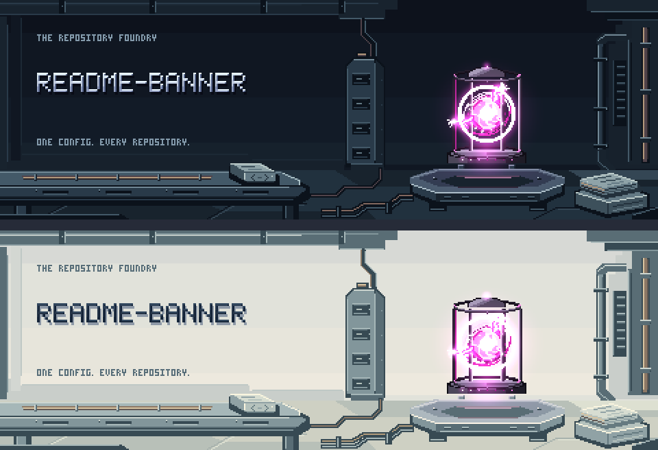
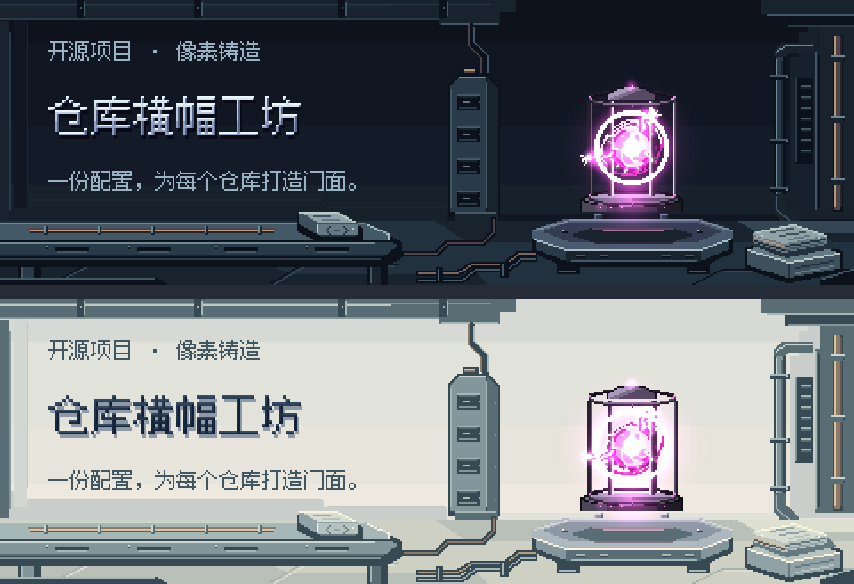
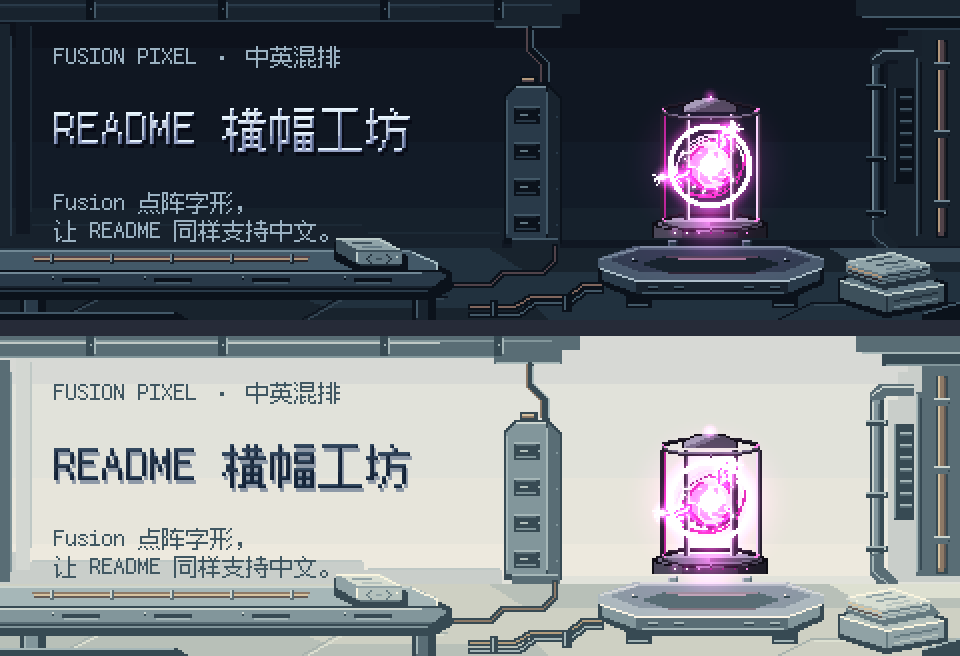
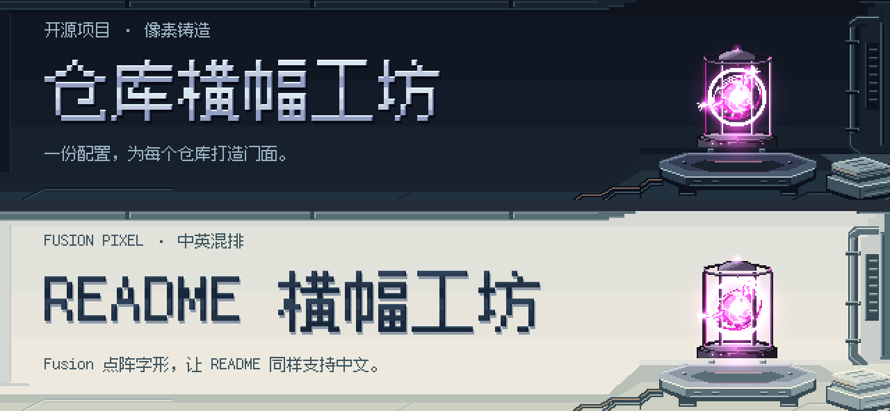

# Repository Foundry：细像素游戏 VFX 横幅样例

> 可复现的实验性样例，含中文、混排与宽幅版本；源码和产物随仓库提供，但尚未注册为主 CLI 的 `pixel` 预设，也不属于 `v0.1.0`。

## 新方案

**一句话：把 README 的生成想象成一间档案铸造工坊，能量核心是真正位于房间里的光源，而不是一个装在 UI 卡片里的小特效。**

- **构图**：左侧留安静的识别区；右侧用核心、铸造台、档案机柜、实体管线和蚀刻金属版构成连续场景。没有按钮、假 HUD 或四角预览框。
- **尺度**：480×160 原生逻辑像素，精确最近邻 2× 导出 960×320。金属亮边、刻槽、管道受光面均保留 1px 细节；不把场景降成粗马赛克。
- **材质**：钢、铜和金属档案版分别使用离散色阶；顶面、侧面、凹槽和接触阴影分开处理，避免平涂矩形堆叠。
- **字形**：原英文对照保留 MIT 的 5×7 / 3×5 字模，产物逐字节不变；新增中文、混排使用同一套本地 Fusion Pixel Font 12px 字模，不用系统字体或英文回退字库。主标题优先 2×，超宽或显式换行时回退到 1×、最多两行，并保留定向亮边与阴影。
- **特效**：保留官方 Energy core 的洋红/紫/白热配色、金属色阶、seed 35 和 `light = 1`。没有为了主题切换擅自降低辉光。
- **光照**：核心的颜色/光缓冲保持原生采样；额外的场景反光从实际核心光能驱动，仅作用于显式暴露材质遮罩。凹槽、底面、接触阴影另有保护遮罩，不做全图扫亮。
- **时间**：采用原库 `renderFrames` 的逐次 `update(1/30)` 调度，共 72 个不同样本、2.4 秒。以原生第 39 帧作为视觉海报/播放起点，整轮只旋转排序，不改动作。
- **导出**：PNG 为静态海报；APNG 为无调色板量化的动画，每帧编码精确 `1/30` 秒。没有用 GIF 量化后的观感代替原色验收。

美术依据：[官方 AUTHORING 规范](https://github.com/patch-gg/pixelfx/blob/a84159688af3ca37a4be05a0d422b94451b2e24e/docs/AUTHORING.md#L172-L211)，以及本仓库的[画风与密度分析](../../docs/pixelfx-art-direction-analysis.md)。

## 样图



- [深色静态 PNG](banner.dark.png) · [浅色静态 PNG](banner.light.png)
- [深色原色动画 APNG](banner.dark.animated.png) · [浅色原色动画 APNG](banner.light.animated.png)
- [四个动画阶段](animation-phases.png)
- [显式受光面](receiver-mask.png) · [受保护阴影](protected-mask.png)

APNG 的扩展名仍是 `.png`；支持 APNG 的查看器会播放，普通静态查看器只显示首帧。真实播放是否丢帧受查看器影响，文件本身的时基是精确 30fps。

## 中文与中英混排

这两组是已经实际渲染、独立逐帧解码验证的本地产物，不是系统字体截图；尚未注册为主 CLI 的 `pixel` 预设。[中文深色 / 混排浅色总览](localization-preview.png)。

### 中文



[深色 PNG](chinese/banner.dark.png) · [浅色 PNG](chinese/banner.light.png) · [深色 APNG](chinese/banner.dark.animated.png) · [浅色 APNG](chinese/banner.light.animated.png)

### 中英混排



[深色 PNG](mixed/banner.dark.png) · [浅色 PNG](mixed/banner.light.png) · [深色 APNG](mixed/banner.dark.animated.png) · [浅色 APNG](mixed/banner.light.animated.png)

- **本地字体**：固定官方 `2026.10.25` 的 12px 等宽 `zh_hans` 完整 BDF，37,857 条字模记录，37,856 个可渲染 Unicode 标量；约 653KB gzip，无删字子集。中文覆盖广但不是所有 Unicode/生僻字都具备，缺字会给出字段名和 `U+` 编码，绝不默默显示方框。
- **真实度量**：使用 BDF 的 `DWIDTH`、`BBX`、ascent/descent。常见英文半宽 6px、汉字全宽 12px，共享基线，保留大小写和下伸部。不按 UTF-16 长度或黑色像素裁切宽度计量。
- **尺度**：原生字体 12px；主标题优先将字模整数放大 2×，其他字段 1×；最后整个 480×160 场景再最近邻 2× 导出。不会因为引入中文便把场景降采样或重采样特效。
- **排版**：固定左侧安全区，不接触右侧机械和动画。标题先试 2× 单行，不合适才试 1×、最多两行；标签一行，说明最多两行。真实墨迹外溢和阴影也必须在安全区内。超出行数/高度/宽度明确失败，不截字。
- **换行**：支持 LF/CRLF，采用 NFC（不是 NFKC）；英文单词、内部连字符/撇号、NBSP 不随意拆分，常见中文开/闭标点按禁则换行。软换行会消耗边界 ASCII 空格。采用最少行数、再平衡行长的确定性方案；这是明确的 CJK/拉丁子集，不是完整 UAX14 或复杂文字塑形引擎。残留组合序列、ZWJ、变体选择符及控制符明确拒绝。
- **字模而非字体引擎**：[字体读取器](fusion-font.mjs)只在本地验证 SHA-256、解压和解析原始点阵，不用浏览器/FreeType、抗锯齿或网络。两枚高于常规 12px 行框的日文重复符号也会测量实际墨迹高度，不截断。
- **原图层保留**：[场景](foundry.px.js)另外提供无标签版本，Fusion 文字一次绘入；不是拿矩形涂掉英文后再覆盖。环境、原生核心、受光/阴影遮罩、72 帧与精确 30fps 均不变。

修改[中文配置](text.zh.json)或[混排配置](text.mixed.json)，再执行：

```bash
node examples/pixel-game-vfx/generate.mjs --text-config examples/pixel-game-vfx/text.zh.json --out chinese
node examples/pixel-game-vfx/generate.mjs --text-config examples/pixel-game-vfx/text.mixed.json --out mixed
# 两个参数必须一起提供；--out 仅接受本样例内的一个安全小写子目录名。
node examples/pixel-game-vfx/generate.mjs --text-config examples/pixel-game-vfx/text.zh.json --out chinese --check
node examples/pixel-game-vfx/generate.mjs --text-config examples/pixel-game-vfx/text.mixed.json --out mixed --check
python examples/pixel-game-vfx/verify.py chinese
python examples/pixel-game-vfx/verify.py mixed
python examples/pixel-game-vfx/verify-locales.py
node examples/pixel-game-vfx/fonts/verify-font.mjs
```

配置仅允许 `schemaVersion: 1`、`label`、`title`、`tagline`，三个文本均必须非空；每字段上限 512 个码点，JSON 上限 64KiB。不执行配置里的代码。参数、字体、所有文字字段和输出目标先验证；`--check` 不写文件。独立解码器默认为旧英文对照，选择子目录后只读写该子目录的 QA 产物。

验证见[跨语言对照报告](localization-report.json)、[中文逐帧报告](chinese/decoding-report.json)、[混排逐帧报告](mixed/decoding-report.json)与[排版回归测试](../../test/fusion-text.test.mjs)。字体的完整来源、固定哈希、四份上游许可和可重取脚本见[字体说明](fonts/README.md)。

## 新版宽幅 README 构图（推荐）



- **比例**：新场景原生 640×144，整数 2× 导出 **1280×288（40:9，约 4.44:1）**；不是将旧图压扁。
- **同宽比较**：在 README 中同样显示为 960px 宽，旧图高 320px，新图高 **216px，减少 32.5%**。
- **文字优先**：文字安全区从 209/480（约 43.5%）扩大到 **404/640（约 63.1%）**；示例主标题字模由 2× 提到 4×。计入新图更宽的显示缩放后，同样 960px 显示宽度下，标题行框由 48px 变成 **72px，增大 50%**。这不是把整个场景像素都放大；只有标题按整数倍排版。
- **场景降为点缀**：保留右侧核心、铸造台与管道的原生 1px 材质细节，仅作整数坐标平移；左侧重新绘制安静的墙面与浅地面，不再让大面积前景机械抢占文字。
- **文字与动画保真**：中文和混排文案、完整 Fusion 字模均未改动；原库核心的配色、72 帧、精确 30fps 与 2.4 秒周期保留。受光面和阴影遮罩随材质一同平移，保护区仍不闪动。
- **自适应边界**：宽幅标题优先 4× 单行，必要时依次降为 3×、2×、1×；仍不合适才试 1× 两行。所有字形、实际墨迹和阴影必须留在声明的安全区；不截字、不覆盖特效。旧布局与已有产物保留。

[中文深色 PNG](wide-chinese/banner.dark.png) · [中文浅色 PNG](wide-chinese/banner.light.png) · [中文深色 APNG](wide-chinese/banner.dark.animated.png) · [中文浅色 APNG](wide-chinese/banner.light.animated.png)

[混排深色 PNG](wide-mixed/banner.dark.png) · [混排浅色 PNG](wide-mixed/banner.light.png) · [混排深色 APNG](wide-mixed/banner.dark.animated.png) · [混排浅色 APNG](wide-mixed/banner.light.animated.png)

```bash
node examples/pixel-game-vfx/generate.mjs --layout wide --text-config examples/pixel-game-vfx/text.zh.json --out wide-chinese
node examples/pixel-game-vfx/generate.mjs --layout wide --text-config examples/pixel-game-vfx/text.mixed.json --out wide-mixed
# 相同命令加 --check 可验证逐字节复现，不写入。
python examples/pixel-game-vfx/verify.py wide-chinese
python examples/pixel-game-vfx/verify.py wide-mixed
python examples/pixel-game-vfx/verify-wide.py
```

布局见[宽幅场景](wide-room.mjs)，独立验证见[宽幅报告](wide-layout-report.json)和[回归测试](../../test/wide-banner.test.mjs)。`--layout` 缺省仍为 `classic`；宽幅模式必须显式提供文字配置和独立输出目录，不覆盖旧版样例。

## 实现分工

| 部分 | 实际采用 |
|---|---|
| 原创房间、材质和几何遮罩 | [pxl 场景源码](foundry.px.js) |
| 原英文 5×7 字模、原生核心、双缓冲合成 | pixelfx；不使用 gallery 的专有 Patch Pixel 字体 |
| 中文/混排字模 | Fusion Pixel Font 12px monospaced zh_hans，OFL 1.1；完整原始 BDF 本地 gzip |
| 中文/混排布局与点阵绘制 | [排版器](pixel-text.mjs)与[场景文字集成](localized-text.mjs) |
| 静态 PNG 编码 | pxl |
| 原色 APNG 编码 | Pixelbolt；编码后只修正时间分数及对应 CRC，不修改压缩图像数据 |
| 编排、区域保护、哈希与复现检查 | [生成脚本](generate.mjs) |
| 精确帧率适配 | [独立时间适配器](apng-timing.mjs) |

这是用代码绘制的原创环境和库内既有特效，不是调用文生图模型生成的图片，也没有冒充重新创作了官方核心。

## 复现

本机使用 Node 24.22.1。pxl 的源码 TypeScript 加载路径需要 Node ≥22.18 的对应能力；没有向本项目增加 npm 运行时依赖，也没有安装全局 Skill/MCP。

本样例复用此前研究时下载的三个**固定、干净源码检出**：

| 忽略目录下的子目录 | 固定提交 |
|---|---|
| `claude-pxl` | `21fee41f7ecce00bc868d7567f24ffd0f3acc8fa` |
| `pixelfx` | `a84159688af3ca37a4be05a0d422b94451b2e24e` |
| `pixelbolt` | `928287703637dc9d6b646adb1f4d2963fd28f6eb` |

检出位置为 `.verification/vendor/`。生成器在执行任何场景前检查 HEAD 和工作树洁净状态。不接受外部上传的任意 JavaScript；pxl 的 VM 不是恶意代码沙箱。

如果没有这些检出，请在上述位置分别克隆 [claude-pxl](https://github.com/crsolver/claude-pxl)、[pixelfx](https://github.com/patch-gg/pixelfx)、[Pixelbolt](https://github.com/skulitom/Pixelbolt)，再切到表中精确提交；不要覆盖已有目录或把未知脚本当配置运行。

```bash
node examples/pixel-game-vfx/generate.mjs
node examples/pixel-game-vfx/generate.mjs --check
# 可选的独立解码检查，需要本地已有 Pillow / numpy；本样例不自动安装它们
python examples/pixel-game-vfx/verify.py
```

`--check` 重新采样并逐字节比较结果，不写入生成文件。每个产物限制 2,000,000 字节；这是本样例的产品预算，不是 GitHub 平台限制，也不是运行内存沙箱。

## 验证与边界

- [生成验证数据](verification.json)：实际尺寸、精确时基、原生帧哈希、主题间特效一致性、受保护区域变化计数。
- [独立解码报告](decoding-report.json)由[可复现检查脚本](verify.py)生成：Pillow 逐帧解码 APNG，与源 RGBA 哈希比较，验证真实像素没有编码损失、每个 2×2 块相同、保护区和动画区域之外保持静止，且显式受光面确实出现可见动态反光。
- [时间适配器测试](../../test/game-vfx-timing.test.mjs)：验证时间分数、输入不变性、图像块不变性、CRC 和损坏输入拒绝。
- 检查导出播放接缝，以及海报旋转排序后位于内部的原生 `71→0` 接缝；各自与普通相邻帧比较，并查看[原生边界前后四帧](native-loop-boundary.png)，不是只用 `t % duration` 便宣称一切无缝。
- 深浅两套环境分别在实际不透明背景上合成，不把适合深底的透明光晕直接拿去套白底。
- 这里只验证本地文件与渲染，没有擅自上传 GitHub 测试 Camo、README 主题切换或 reduced-motion。动画文件自身不具备读取系统 reduced-motion 的能力；正式集成时仍需静态回退与 README 嵌入测试。

许可证与来源见 [第三方声明](THIRD_PARTY_NOTICES.md)。
