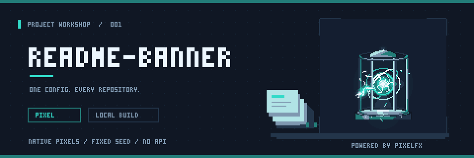
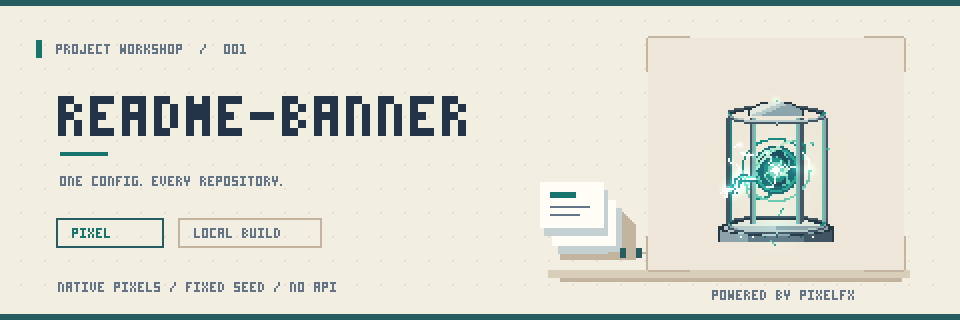

# pixel：本地组合原型

**早期组合研究样张，不是已经注册的 CLI 预设。** 对外名称为 `pixel`（像素风），不是 `pixelfx`。本目录保留最初的工具组合验证；更精细的美术、中文与宽幅版本见[细像素工坊](../pixel-game-vfx/README.md)。这些示例不改变主 CLI 的依赖或根 README 的顶部横幅。

## 看效果

深色动画：



浅色静帧：



[深浅对比](comparison.png) · [深色无损 APNG](banner.dark.animated.png) · [浅色无损 APNG](banner.light.animated.png) · [浅色 GIF](banner.light.gif)

APNG 使用 `.animated.png` 文件名。本轮仅完成本地编码、解码和画面验证，**未在真实 GitHub README/Camo 上发布测试**。不能据此承诺所有 GitHub 客户端的动画、主题或 reduced-motion 行为；静态 PNG 始终保留。

## 三个工具各做一件事

| 组件 | 本例职责 | 不是它做的事情 |
| --- | --- | --- |
| [pxl](https://github.com/crsolver/claude-pxl) | [绘图源文件](workshop.px.js)的像素排版、文字、纸张、工作台；静态 PNG、共享调色板 GIF 编码 | 不是图片生成模型；不是把照片缩小就得到好像素画 |
| [pixelfx](https://github.com/patch-gg/pixelfx) | `scifi/energy-core` 的色彩与光照帧，固定 seed | 不生成整张 README 布局，不自动识别品牌 Logo 的正面和阴影 |
| [Pixelbolt](https://github.com/skulitom/Pixelbolt) | 已合成 RGBA 帧的无损 APNG 编码 | 没有调用受 256×256 动画画布限制的 `renderProject` |

素材来源是**AI 编写的像素绘图代码 + 上游程序化特效**，不是文生图模型，也没有上传图片或调用付费生成服务。代理编写、看图修改仍会消耗模型 token；“本地渲染”不等于整个创作流程零成本。

独立的反应堆区域可以动，标题、纸张、按钮、地面及其余背景保持固定。这里没有给项目 Logo 自动加扫光，避免再次把阴影当成发光表面。

## 固定参数与实测

- 逻辑画布 480×160；全部导出为 **960×320、严格最近邻 2 倍**。
- 30 帧 × 80ms = 2.4 秒，12.5fps；无限循环，不重复编码终点。
- 效果 stage 为 `(324,19,128,116)` 逻辑像素；每个主题单独实例化、对实际背景合成加色光。
- 源码 HEAD 和干净工作区校验；不接受浮动版本或有未记录修改的源码。
- `--check` 按字节比较全部输出；每项限制 2,000,000 字节。固定原型规模并不等于生产级 CPU/RAM 沙箱。
- [生成记录](verification.json)：两个主题原始帧 stage 外变化为 0。
- 本地独立 Pillow 解码 PNG/APNG/GIF：均为 30 帧、2400ms；APNG 首帧与静态 PNG 逐字节像素相等；GIF/APNG 的 stage 外像素在所有帧保持不变；所有 2×2 像素块严格一致。
- GIF 使用全动画共享调色板；超过 256 色时发生统一量化，**不保证其颜色与无损 APNG 完全相同**。

| 主题 | 静态 PNG | 无损 APNG | GIF |
| --- | ---: | ---: | ---: |
| dark | 13,798 B | 436,365 B | 340,744 B |
| light | 11,548 B | 361,731 B | 309,128 B |

## 复现

仅在信任并愿意执行这些第三方源码时操作。实际测试环境为 Node 24.22.1；此直接源码示例需要 **Node >=22.18** 的 TypeScript 类型擦除能力和 Git。正式 CLI 的 Node 要求没有因此更改。

以下命令在仓库根目录执行，目的目录必须不存在；已有目录不要覆盖。源码 checkout 在忽略目录中，不是全局 Skill 或项目 npm 依赖。

```bash
git clone https://github.com/crsolver/claude-pxl.git .verification/vendor/claude-pxl
git -C .verification/vendor/claude-pxl checkout 21fee41f7ecce00bc868d7567f24ffd0f3acc8fa
git clone https://github.com/patch-gg/pixelfx.git .verification/vendor/pixelfx
git -C .verification/vendor/pixelfx checkout a84159688af3ca37a4be05a0d422b94451b2e24e
git clone https://github.com/skulitom/Pixelbolt.git .verification/vendor/pixelbolt
git -C .verification/vendor/pixelbolt checkout 928287703637dc9d6b646adb1f4d2963fd28f6eb
node examples/pixel-prototype/generate.mjs
node examples/pixel-prototype/generate.mjs --check
```

[绘图源文件](workshop.px.js) · [合成与编码](generate.mjs) · [第三方声明](THIRD_PARTY_NOTICES.md) · [工具组合调研](../../docs/pixel-toolchain-research.md)

## 接入产品还缺什么

JSON `preset: pixel`、二进制写入/漂移检查、多资产清单、主题与 reduced-motion 片段、受限 PNG/mask 输入、字形校验、资源预算及真实 GitHub 验证，均需独立实现。不能把这个研究脚本的任意 JavaScript 输入直接开放给仓库配置。
